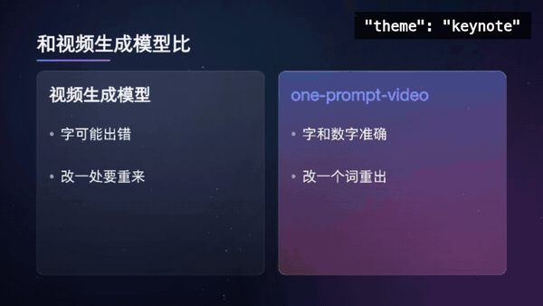
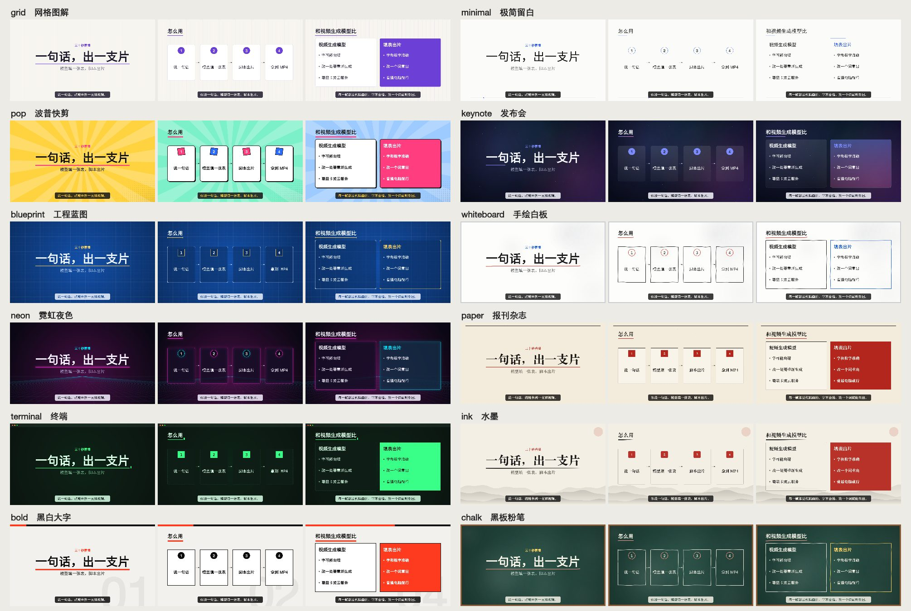
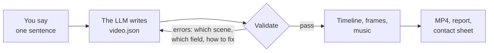
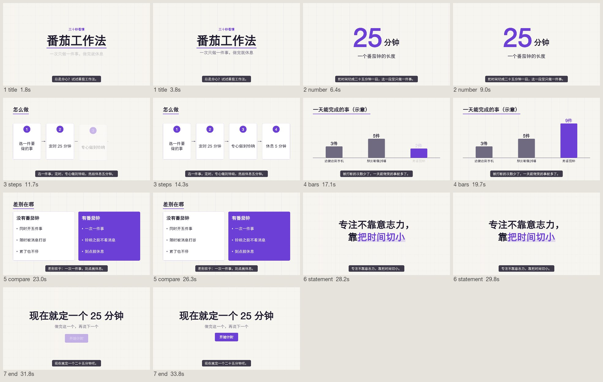
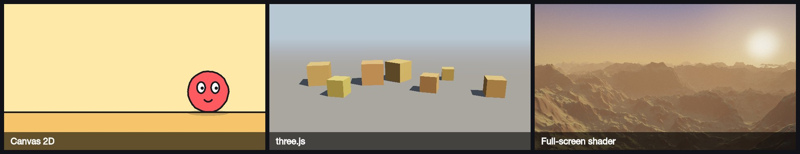

<div align="center">

# one-prompt-video

### One prompt in, one video out

Say one sentence → the LLM fills in a form → one command renders an MP4 with music and captions

[简体中文](README.md) · English


</div>

Full version with narration and score, 42 seconds. **GitHub's player starts muted: press play, then click the speaker icon at the bottom right.** The same goes for every video on this page:

https://github.com/user-attachments/assets/7da9e384-5efd-4d13-9077-716861572c67

<sub>Every frame is rendered by this skill's engine: three hand-written scenes plus built-in layouts, with sources in <a href="docs/demos/trailer-en">docs/demos/trailer-en</a>. The score uses GarageBand instrument samples and the narration is an AI voice from Doubao TTS; both methods are described in the skill's <a href="one-prompt-video/references/external-tools.md">external-tools.md</a>.</sub>

## What it is

An [Agent Skill](https://agentskills.io). Install it into Claude Code, Codex, or any agent that supports skills, say one sentence, and get back a 20 to 90 second video: explainers, product intros, data stories, knowledge cards, in landscape or portrait.

- **No video generation model.** Every frame is drawn by code. Text is never garbled, numbers are exact, the same input always gives the same video, and a fix is a one-word edit followed by a re-render.
- **The model only fills in a form.** It picks from nine layouts and fills in text and numbers. Timing, drawing, music, encoding and self-checks are done by scripts.
- **No ceiling on style.** The built-in themes are a starting point: swap colors and fonts, or write the drawing code for any scene. Stronger models can also bring in Blender, real-instrument scores and AI narration.
- **Small models can run it.** When the form is wrong, the script says which scene, which field, and what the correct form looks like.
- **Lightweight.** Node.js and ffmpeg. No GPU, no browser. A 30-second 1080p video renders in about 13 seconds on an Apple Silicon laptop.

## Gallery

Each of the four videos below is rendered from a single `video.json`. Narration is Doubao TTS, with a different voice, tone and pace for each video. The scores are GarageBand instrument samples, with a different arrangement for each. Both come from the skill's external-tools methods: narration needs your own API key, and sample-based scores can only be made on macOS. A single cover frame has been added at the start of each so that the player shows a meaningful cover. The player starts muted, so click the speaker icon.

### One hand-written scene plus layouts

"What is one-prompt-video": one of the seven scenes is custom drawing code (the one where a sentence becomes `video.json` and then an MP4). The rest are built-in layouts. A calm male voice; piano, horns, choir and harp.

https://github.com/user-attachments/assets/56d3aaf9-4331-4453-a1c6-8be83d848a17

### Form only

"One prompt in, one video out": seven scenes, all built-in layouts, grid theme. A bright female voice; acoustic guitar, piano and upright bass. The theme preview and the contact sheet further down come from its Chinese version.

https://github.com/user-attachments/assets/a6af9fa9-fe9d-4097-92a6-03cbd148a407

"From one sentence to MP4": eight scenes, all built-in layouts, blueprint theme. A steady male voice; synth pad, plucks and electronic drums.

https://github.com/user-attachments/assets/5c3f65bf-3ed3-4f40-bf06-600a764e2309

"Small models can make videos too": portrait, pop theme, using this repository's own test numbers. A fast, lively female voice; marimba, electric bass and vibraphone.

https://github.com/user-attachments/assets/0aa34997-b250-4b0a-ace8-a029054c62f0

### No ceiling on style

One scene cycling through eighteen looks. The first twelve are the built-in themes, a one-word change. The other six are built-in themes with a few colors replaced through `colors`; you can make as many of those as you like.



When that is not enough, write the drawing code for a scene, use one of the three reference pipelines, or bring in external tools. See "Going further" below.

The built-in themes, three scenes each (in Chinese):



## How it works



The timeline follows the beat of the theme: every scene lasts a whole number of beats, and cuts and sound effects land on the beat, so picture and music stay in step.

This file is all the model writes:

```json
{
  "title": "One prompt in, one video out",
  "theme": "grid",
  "aspect": "16:9",
  "seconds": 32,
  "scenes": [
    { "layout": "title", "title": "One prompt in, one video out", "subtitle": "The model fills in a form. Scripts render it.", "say": "Say one sentence. Get a finished video." },
    { "layout": "steps", "title": "How it works", "items": ["Say one sentence", "The model fills in a form", "Scripts render it", "You get an MP4"] },
    { "layout": "number", "value": "13", "unit": "s", "label": "to render a 35-second 1080p video", "note": "Measured on an Apple Silicon laptop" },
    { "layout": "end", "title": "One prompt in, one video out", "cta": "Try it" }
  ]
}
```

When the file is wrong, the script lists every problem at once, each with a correct example. The messages are in Chinese for now; this one says that scene 2 needs 2 to 6 bar items with numeric values, and that scene 3 is missing `items`:

```text
[出错] video.json 有 2 处要改：
  1. 第 2 场（bars）的 "items" 要是 2 到 6 项，每项有 "label"（文字）和 "value"（不带引号、不小于 0 的数字）。正确的写法：{ "layout": "bars", "title": "场标题", "unit": "%", "items": [{ "label": "甲", "value": 40 }, { "label": "乙", "value": 75 }] }
  2. 第 3 场（bullets）缺 "items"。正确的写法：{ "layout": "bullets", "title": "场标题", "items": ["第一条", "第二条", "第三条"] }
```

After rendering, the script checks resolution, duration, loudness, true peak and text overflow, and writes a contact sheet with two frames per scene so that a person or a model can review the whole video at a glance:



## Quick start

### 1. Install the skill

```bash
git clone --depth 1 https://github.com/li2092/one-prompt-video.git

# Claude Code
mkdir -p ~/.claude/skills && cp -r one-prompt-video/one-prompt-video ~/.claude/skills/

# Codex
mkdir -p ~/.codex/skills && cp -r one-prompt-video/one-prompt-video ~/.codex/skills/
```

Windows (PowerShell):

```powershell
git clone --depth 1 https://github.com/li2092/one-prompt-video.git
Copy-Item -Recurse one-prompt-video\one-prompt-video "$HOME\.claude\skills\one-prompt-video"
```

The videos and GIFs on this page are stored on GitHub's attachment service, not in the repository, so the download is only a megabyte or two.

For other agents, put the folder wherever that agent loads skills from. For a model without skill support, paste the content of `one-prompt-video/SKILL.md` into the conversation and replace `SKILL` with the absolute path of the folder.

### 2. Say one sentence

```text
Make a 30-second video that introduces the one-prompt-video skill
Turn this into a short video: six small-model test runs took 68, 78, 61, 51, 57 and 65 seconds, and all of them passed on the first try
Make a portrait video: one sentence in, one video out, no GPU, no video generation model
```

On first use the agent runs an environment check. If the drawing library or ffmpeg is missing, it installs them or tells you how.

### Without an agent

```bash
mkdir my-videos && cd my-videos
node /path/to/one-prompt-video/scripts/setup.mjs
mkdir demo && cp /path/to/one-prompt-video/assets/example.video.json demo/video.json
node /path/to/one-prompt-video/scripts/make.mjs demo/video.json     # output in demo/out/
```

## Nine layouts

| Layout | Use it for | Layout | Use it for |
|---|---|---|---|
| `title` | Opening | `steps` | A sequence or process |
| `statement` | One line worth remembering | `compare` | Two things side by side |
| `bullets` | A few parallel points | `quote` | Quoting someone |
| `number` | One key figure, counting up from 0 | `end` | Closing, with an optional button |
| `bars` | Bar chart | `custom` | Your own drawing code for one scene |

Any scene can carry a `say` line, shown as a caption. All fields are documented in [`references/video-json.md`](one-prompt-video/references/video-json.md) (Chinese).

## Built for small models

Tested with Claude Haiku, a small model, on three prompts (explaining a concept, a portrait product video, a data story), two rounds each. The model read only `SKILL.md`. All six runs succeeded on the first attempt with no failed command, at about one minute per run. The prompts and the grading script are in [`evals/`](evals).

Design choices that make this work:

- `SKILL.md` is about 120 lines. Everything else is read on demand.
- The model writes no drawing code, computes no timings and tunes no parameters.
- Validation reports every problem in one pass, each with a correct example.
- Trailing commas and stray code fences are tolerated.
- Text that is too long is shrunk automatically and flagged in the report.
- Chinese is wrapped by word, so a word is never split across lines.

## Going further

From the nearest step to the furthest:

| You want | How |
|---|---|
| Custom colors, fonts, or a fixed length for one scene | [`references/video-json.md`](one-prompt-video/references/video-json.md) |
| Voice-over | The skill ships no voice service; bring your own. Drop in recordings or plug in your own TTS: [`references/voice.md`](one-prompt-video/references/voice.md) |
| One scene with special visuals | Write the drawing code for that scene; the rest stay as layouts: [`references/custom-scenes.md`](one-prompt-video/references/custom-scenes.md) |
| Cartoon shorts, 3D scenes, landscapes | Three reference pipelines: [`references/pipelines.md`](one-prompt-video/references/pipelines.md) |
| Photoreal rendering, real instruments, AI narration | External tools: [`references/external-tools.md`](one-prompt-video/references/external-tools.md) |

Each reference pipeline ships with a minimal runnable project, intended for stronger models:



### With external tools

When the user's machine has the software or the account, a stronger model can use these three methods. Instructions and minimal projects are in [`references/external-tools.md`](one-prompt-video/references/external-tools.md) (Chinese):

- Blender rendering: global illumination, real materials, reflections, depth of field. Needs an installed Blender.
- Instrument-sample scores: real brass, choir, harp and timpani. Needs GarageBand or Logic on macOS.
- Doubao TTS narration: natural Chinese speech, plus English and Japanese. Needs your own Volcano Engine API key.

The trailer at the top of this page uses the last two. The 8-second clip below was made by the author with the Blender route. Its project is far more elaborate than the minimal one shipped with the skill (hand-built architecture and terrain plus CC0 trees and rocks), and it took 5 hours 37 minutes to render at 1080p. It is here to show the ceiling of that route. Installing the skill does not mean one sentence will produce a clip like this.

https://github.com/user-attachments/assets/225be1e4-821d-4b5b-9432-e9ffde8ccc12

The sources of the demo videos on this page are in [`docs/demos/`](docs/demos), so they can be re-rendered.

## What it is not

| | This skill | Video generation models |
|---|---|---|
| Where frames come from | Code draws them | A model generates pixels |
| Text and numbers | Exact, identical to the input | May be wrong |
| Changing one thing | Edit one word and re-render; the rest stays the same | Regenerate; everything may change |
| Live-action look, real people, camera work | No | Yes |
| Hardware | Any ordinary computer | A GPU or a cloud service |

It makes layout-based videos that explain one thing clearly. Live-action footage, real people on camera and character-driven stories are out of scope, and so is editing existing footage.

## Status

- Version 0.4.0. Tested on macOS (Apple Silicon) only. The Windows and Linux code paths are written but have not been run yet; reports are welcome.
- Without external tools, the default output has code-synthesized music and no voice-over, which is plainer than the demos above. Compare with [the default output of the same "One prompt in, one video out"](https://github.com/user-attachments/assets/382dc542-a11a-47e3-85dd-1de3ded48b5d).
- Music, both built-in and sample-based, has only been measured for loudness and peaks; whether it sounds good is for you to judge.
- The skill instructions (`SKILL.md`, `references/`) and the script messages are in Chinese for now. Video content can be in any language, and English typesetting is supported.

## Repository layout

```text
one-prompt-video/            the skill itself; this is the folder you install
  SKILL.md                   main instructions read by the model
  scripts/                   setup.mjs, make.mjs, browser-render.mjs, engine/
  references/                documents read on demand
  assets/                    example video.json, theme preview, minimal projects for the reference pipelines
evals/                       test prompts and grading script
docs/                        images for this page; demo sources are in docs/demos/
```

## Authors and license

By JiMiL and vivhuang. Licensed under [MIT](LICENSE). Dependencies and the sources of the methods used are listed in [`references/sources.md`](one-prompt-video/references/sources.md).
