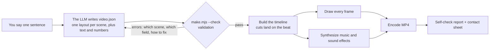

<div align="center">

# one-prompt-video

### One prompt in, one video out

Say one sentence → the LLM fills in a form → one command renders an MP4 with music and captions

[简体中文](README.md) · English


<sub>"The Pomodoro Technique", rendered from a single seven-scene `video.json`. The GIF is silent; the real output has music and sound effects.</sub>

</div>

## What it is

An [Agent Skill](https://agentskills.io). Install it into Claude Code, Codex, or any agent that supports skills, say one sentence, and get back a 20 to 90 second video: explainers, product intros, data stories, knowledge cards, in landscape or portrait.

- **No video generation model.** Every frame is drawn by code. Text is never garbled, numbers are exact, the same input always gives the same video, and a fix is a one-word edit followed by a re-render.
- **The model only fills in a form.** Nine layouts and six themes to pick from. Timing, drawing, music, encoding and self-checks are done by scripts.
- **Small models can run it.** When the form is wrong, the script says which scene, which field, and what the correct form looks like.
- **Lightweight.** Node.js and ffmpeg. No GPU, no browser. A 30-second 1080p video renders in about 13 seconds on an Apple Silicon laptop.

## Gallery

<table>
<tr>
<td width="62%" valign="top">

**Switch themes by changing one word**


Same content, a different `"theme"` value.

</td>
<td width="38%" valign="top">

**Portrait**


Written by Claude Haiku from one sentence (in Chinese): a portrait short video for new noise-cancelling headphones, 40-hour battery, transparency mode, priced at 199 yuan.

</td>
</tr>
</table>

Six themes, four scenes each:


Chinese works the same way:


## How it works



This file is all the model writes:

```json
{
  "title": "The Pomodoro Technique",
  "theme": "keynote",
  "aspect": "16:9",
  "seconds": 30,
  "scenes": [
    { "layout": "title", "title": "The Pomodoro Technique", "subtitle": "One task at a time, then take a break", "say": "Always distracted? Try the Pomodoro Technique." },
    { "layout": "number", "value": "25", "unit": "min", "label": "The length of one pomodoro", "say": "Split your time into 25-minute blocks." },
    { "layout": "steps", "title": "How it works", "items": ["Pick one task", "Set a 25-minute timer", "Focus until it rings", "Rest for 5 minutes"] },
    { "layout": "end", "title": "Set a 25-minute timer now" }
  ]
}
```

When the file is wrong, the script lists every problem at once, each with a correct example. The messages are in Chinese for now; this one says that scene 2 needs 2 to 6 bar items with numeric values, and that scene 3 is missing `items`:

```text
[出错] video.json 有 2 处要改：
  1. 第 2 场（bars）的 "items" 要是 2 到 6 项，每项有 "label"（文字）和 "value"（不带引号、不小于 0 的数字）。正确的写法：{ "layout": "bars", "title": "场标题", "unit": "%", "items": [{ "label": "甲", "value": 40 }, { "label": "乙", "value": 75 }] }
  2. 第 3 场（bullets）缺 "items"。正确的写法：{ "layout": "bullets", "title": "场标题", "items": ["第一条", "第二条", "第三条"] }
```

After rendering, the script checks resolution, duration, loudness, true peak and text overflow, and writes a contact sheet with two frames per scene so that a person or a model can review the whole video at a glance:


## Quick start

**1. Install the skill**

```bash
git clone https://github.com/li2092/one-prompt-video.git

# Claude Code
mkdir -p ~/.claude/skills && cp -r one-prompt-video/one-prompt-video ~/.claude/skills/

# Codex
mkdir -p ~/.codex/skills && cp -r one-prompt-video/one-prompt-video ~/.codex/skills/
```

Windows (PowerShell):

```powershell
git clone https://github.com/li2092/one-prompt-video.git
Copy-Item -Recurse one-prompt-video\one-prompt-video "$HOME\.claude\skills\one-prompt-video"
```

For other agents, put the folder wherever that agent loads skills from. For a model without skill support, paste the content of `one-prompt-video/SKILL.md` into the conversation and replace `SKILL` with the absolute path of the folder.

**2. Say one sentence**

```text
Make a 30-second video that explains compound interest
Turn this into a short video: customer satisfaction over four quarters was 72, 78, 85, 91. Highlight the 19-point rise.
Make a portrait video for our new noise-cancelling headphones: 40-hour battery, priced at $29
```

On first use the agent runs an environment check. If the drawing library or ffmpeg is missing, it installs them or tells you how.

**Without an agent**

```bash
mkdir my-videos && cd my-videos
node /path/to/one-prompt-video/scripts/setup.mjs
mkdir demo && cp /path/to/one-prompt-video/assets/example.video.json demo/video.json
node /path/to/one-prompt-video/scripts/make.mjs demo/video.json     # output in demo/out/
```

## Nine layouts

| Layout | Use it for | Layout | Use it for |
|---|---|---|---|
| `title` | Opening | `steps` | A sequence or process |
| `statement` | One line worth remembering | `compare` | Two things side by side |
| `bullets` | A few parallel points | `quote` | Quoting someone |
| `number` | One key figure, counting up from 0 | `end` | Closing, with an optional button |
| `bars` | Bar chart | `custom` | Your own drawing code for one scene |

Any scene can carry a `say` line, shown as a caption. All fields are documented in [`references/video-json.md`](one-prompt-video/references/video-json.md) (Chinese).

## Built for small models

Tested with Claude Haiku, a small model, on three prompts (compound interest, a portrait product video, a satisfaction data story), two rounds each. The model read only `SKILL.md`. All six runs succeeded on the first attempt with no failed command, at about one minute per run. The prompts and the grading script are in [`evals/`](evals).

Design choices that make this work:

- `SKILL.md` is about 120 lines. Everything else is read on demand.
- The model writes no drawing code, computes no timings and tunes no parameters.
- Validation reports every problem in one pass, each with a correct example.
- Trailing commas and stray code fences are tolerated.
- Text that is too long is shrunk automatically and flagged in the report.
- Chinese is wrapped by word, so a word is never split across lines.

## Going further

| You want | How |
|---|---|
| Custom colors, fonts, or a fixed length for one scene | [`references/video-json.md`](one-prompt-video/references/video-json.md) |
| Voice-over | Drop in your own recordings, or plug in your own TTS command: [`references/voice.md`](one-prompt-video/references/voice.md) |
| Something the layouts cannot do | Write the drawing code for that scene: [`references/custom-scenes.md`](one-prompt-video/references/custom-scenes.md) |
| Videos beyond layout-based explainers | Three reference pipelines: [`references/pipelines.md`](one-prompt-video/references/pipelines.md) |

Each reference pipeline ships with a minimal runnable project, intended for stronger models:


## What it is not

| | This skill | Video generation models |
|---|---|---|
| Where frames come from | Code draws them | A model generates pixels |
| Text and numbers | Exact, identical to the input | May be wrong |
| Changing one thing | Edit one word and re-render; the rest stays the same | Regenerate; everything may change |
| Live-action look, real people, camera work | No | Yes |
| Hardware | Any ordinary computer | A GPU or a cloud service |

It makes layout-based videos that explain one thing clearly. Live-action footage, real people on camera and character-driven stories are out of scope, and so is editing existing footage.

## Status

- Version 0.1.0. Tested on macOS (Apple Silicon) only. The Windows and Linux code paths are written but have not been run yet; reports are welcome.
- Music and sound effects are synthesized by code. Loudness and peaks are measured; whether it sounds good is for you to judge.
- No voice-over by default.
- The skill instructions (`SKILL.md`, `references/`) and the script messages are in Chinese for now. Video content can be in any language, and English typesetting is supported.

## Repository layout

```text
one-prompt-video/            the skill itself; this is the folder you install
  SKILL.md                   main instructions read by the model
  scripts/                   setup.mjs, make.mjs, browser-render.mjs, engine/
  references/                documents read on demand
  assets/                    example video.json, theme preview, minimal projects for the reference pipelines
evals/                       test prompts and grading script
docs/                        images used on this page
```

## Authors and license

By JiMiL and vivhuang. Licensed under [MIT](LICENSE). Dependencies and the sources of the methods used are listed in [`references/sources.md`](one-prompt-video/references/sources.md).
