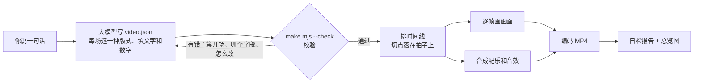

<div align="center">

# one-prompt-video

### 一句话，出一支片

说一句话 → 大模型填一张表 → 一条命令生成带配乐和字幕的 MP4

简体中文 · [English](README.en.md)


<sub>技能自带的示例「番茄工作法」，由一份七场的 `video.json` 渲出。动图没有声音，成片带配乐和音效。</sub>

</div>

## 这是什么

一个 [Agent Skill](https://agentskills.io)。装进 Claude Code、Codex 或任何支持技能的 agent 以后，你说一句话，它就交给你一支 20 到 90 秒的短视频：讲解、科普、产品介绍、数据播报、知识卡片，横屏竖屏都行。

- **不用视频生成模型。** 每一帧都是代码画出来的：字不会错，数字不会变形，同一份输入永远出同一支片，哪里不满意改一个词重出。
- **模型只填一张表。** 九种版式、六种主题，选一选、填一填。排时间、画画面、配乐、编码、自检都由脚本做。
- **小模型也能跑。** 表填错了，脚本逐条说明错在第几场、哪个字段、正确的写法是什么。
- **很轻。** 只要 Node.js 和 ffmpeg，不要显卡，不要浏览器。实测一支 30 多秒的 1080p 片子十几秒出完（Apple Silicon 笔记本）。

## 看效果

<table>
<tr>
<td width="62%" valign="top">

**换主题只改一个词**


同一份内容，`"theme"` 换一个词就是另一种样子。

</td>
<td width="38%" valign="top">

**竖屏**


小模型 Haiku 照这句话做的：「帮我给新品做个竖屏短视频发抖音：一款降噪耳机，卖点是续航 40 小时、通透模式、售价 199 元」

</td>
</tr>
</table>

六种主题，各取四场：


## 它怎么做到的



模型写的只有这样一份文件：

```json
{
  "title": "番茄工作法",
  "theme": "grid",
  "aspect": "16:9",
  "seconds": 30,
  "scenes": [
    { "layout": "title", "title": "番茄工作法", "subtitle": "一次只做一件事", "say": "总是分心？试试番茄工作法。" },
    { "layout": "number", "value": "25", "unit": "分钟", "label": "一个番茄钟的长度", "say": "把时间切成二十五分钟一段。" },
    { "layout": "steps", "title": "怎么做", "items": ["选一件事", "定时 25 分钟", "专心做到铃响", "休息 5 分钟"] },
    { "layout": "end", "title": "现在就定一个 25 分钟" }
  ]
}
```

写错了会得到这样的反馈，照着改就行：

```text
[出错] video.json 有 2 处要改：
  1. 第 2 场（bars）的 "items" 要是 2 到 6 项，每项有 "label"（文字）和 "value"（不带引号、不小于 0 的数字）。正确的写法：{ "layout": "bars", "title": "场标题", "unit": "%", "items": [{ "label": "甲", "value": 40 }, { "label": "乙", "value": 75 }] }
  2. 第 3 场（bullets）缺 "items"。正确的写法：{ "layout": "bullets", "title": "场标题", "items": ["第一条", "第二条", "第三条"] }
```

出片以后脚本自己查一遍分辨率、时长、响度、真峰值、有没有字放不下，并出一张每场两格的总览图，方便人和模型扫一眼：


## 快速开始

**1. 装技能**

```bash
git clone https://github.com/li2092/one-prompt-video.git

# Claude Code
mkdir -p ~/.claude/skills && cp -r one-prompt-video/one-prompt-video ~/.claude/skills/

# Codex
mkdir -p ~/.codex/skills && cp -r one-prompt-video/one-prompt-video ~/.codex/skills/
```

Windows（PowerShell）：

```powershell
git clone https://github.com/li2092/one-prompt-video.git
Copy-Item -Recurse one-prompt-video\one-prompt-video "$HOME\.claude\skills\one-prompt-video"
```

别的 agent 按它自己的文档放技能目录。不支持技能的模型，把 `one-prompt-video/SKILL.md` 的内容贴进对话，把里面的 `SKILL` 换成这个目录的绝对路径。

**2. 说一句话**

```text
做一个 30 秒的视频，讲清楚什么是复利
把这组数据做成短视频：四个季度的客户满意度是 72、78、85、91 分，突出一年涨了 19 分
帮我给新品做个竖屏短视频：一款降噪耳机，续航 40 小时，售价 199 元
```

第一次用时，agent 会跑一遍环境检查，缺画图库或 ffmpeg 会自动装或告诉你怎么装。

**不经过 agent，直接用脚本**

```bash
mkdir my-videos && cd my-videos
node /path/to/one-prompt-video/scripts/setup.mjs
mkdir demo && cp /path/to/one-prompt-video/assets/example.video.json demo/video.json
node /path/to/one-prompt-video/scripts/make.mjs demo/video.json     # 成片在 demo/out/
```

## 九种版式

| 版式 | 用来 | 版式 | 用来 |
|---|---|---|---|
| `title` | 开头 | `steps` | 先后步骤、流程 |
| `statement` | 一句要让人记住的话 | `compare` | 两样东西对比 |
| `bullets` | 并列的几个要点 | `quote` | 引用别人的话 |
| `number` | 一个关键数字，从 0 滚到目标值 | `end` | 结尾，可带一个按钮 |
| `bars` | 柱状图，比大小 | `custom` | 自己写这一场的画面代码 |

每一场都可以加一句 `say` 作字幕。全部字段见 [`references/video-json.md`](one-prompt-video/references/video-json.md)。

## 为小模型设计

用 Claude 的小模型 Haiku 测了三道题（讲复利、耳机竖屏带货、满意度数据），每道两轮。模型只读 `SKILL.md`，六次都一次跑通，没有一条命令报错，每次约一分钟。测试题和打分脚本在 [`evals/`](evals)。

让小模型跑得通的几个设计：

- `SKILL.md` 只有一百二十多行，其余说明按需再读。
- 模型不写画图代码，不算时间，不调参数。
- 校验一次报出全部问题，每条带正确写法的例子。
- 多余的逗号、外面包了代码围栏这类小毛病，脚本自己容错。
- 字太多时自动缩小字号，并在报告里提醒缩短。
- 中文按词折行，不会把「满意」折成两行。

## 进阶

| 想要 | 怎么做 |
|---|---|
| 换颜色、换字体、固定某一场的秒数 | [`references/video-json.md`](one-prompt-video/references/video-json.md) |
| 加人声 | 放自己的录音，或配一条自己的配音命令：[`references/voice.md`](one-prompt-video/references/voice.md) |
| 现成版式不够 | 某一场换成自己写的画面代码：[`references/custom-scenes.md`](one-prompt-video/references/custom-scenes.md) |
| 做版式片以外的片子 | 三条参考生产线：[`references/pipelines.md`](one-prompt-video/references/pipelines.md) |

三条参考生产线各带一个能跑的最小工程，给能力强的模型用：


## 它不是什么

| | 本技能 | 视频生成模型 |
|---|---|---|
| 画面来源 | 代码逐帧画 | 模型生成像素 |
| 文字和数字 | 准确，和输入一致 | 可能出错 |
| 改一处 | 改一个词重出，其余不变 | 重新生成，整体会变 |
| 实拍感、真人、镜头语言 | 没有 | 有 |
| 硬件 | 普通电脑 | 要显卡或云服务 |

它做的是讲清楚一件事的版式短片。实拍画面、真人出镜、角色表演的故事片不在范围内；剪辑已有的视频也不在范围内。

## 现状

- 版本 0.1.0。只在 macOS（Apple Silicon）上实测过；Windows 和 Linux 的代码路径按文档写了，还没有实测，欢迎反馈。
- 配乐和音效是程序合成的，只量过响度和峰值，好不好听要你自己听。
- 默认没有人声。
- 技能的说明文件和脚本的提示信息目前是中文；片子的内容可以是任何语言，英文排版已支持。

## 目录

```text
one-prompt-video/            技能本体，装的就是这个目录
  SKILL.md                   模型读的主说明
  scripts/                   setup.mjs、make.mjs、browser-render.mjs、engine/
  references/                按需读的说明
  assets/                    示例 video.json、主题预览、参考生产线的最小工程
evals/                       测试题和打分脚本
docs/                        本页用的图
```

## 作者和许可

作者：JiMiL、vivhuang。[MIT](LICENSE) 许可。依赖和做法的出处见 [`references/sources.md`](one-prompt-video/references/sources.md)。
