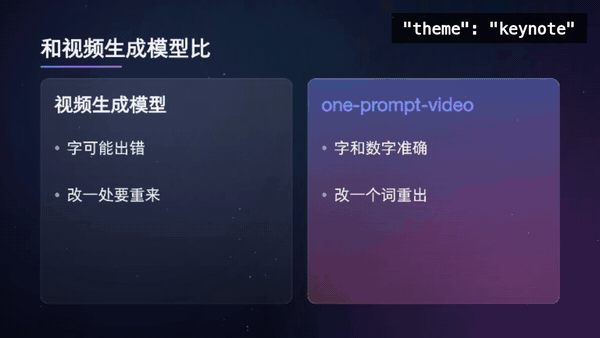
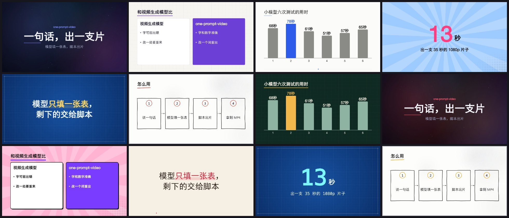
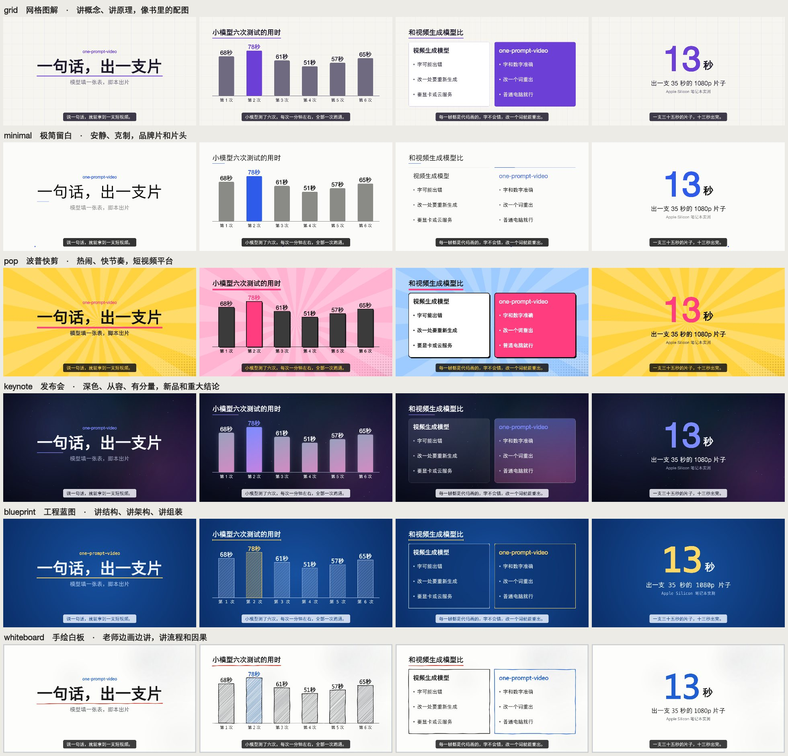
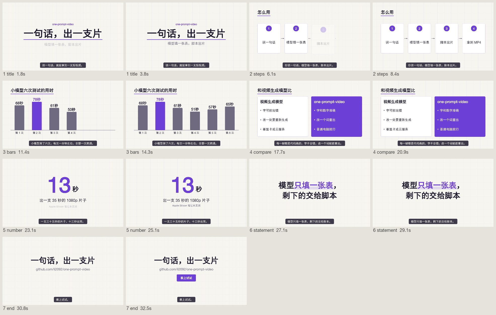
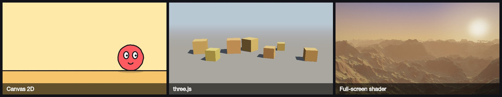

<div align="center">

# one-prompt-video

### 一句话，出一支片

说一句话 → 大模型填一张表 → 一条命令生成带配乐和字幕的 MP4

简体中文 · [English](README.en.md)


</div>

带声音的完整版，43 秒，点开播放：

https://github.com/user-attachments/assets/060c046b-e0f1-4596-abe5-ac39dde2c76c

<sub>画面由本技能的引擎逐帧渲染：自己写的三场画面加现成版式，源文件在 <a href="docs/demos/trailer">docs/demos/trailer</a>。配乐用库乐队（GarageBand）的乐器采样制作，旁白是豆包语音合成的 AI 配音，做法在技能的 <a href="one-prompt-video/references/external-tools.md">external-tools.md</a> 里。下面几支片子用的是技能自带的、程序合成的配乐。</sub>

## 这是什么

一个 [Agent Skill](https://agentskills.io)。装进 Claude Code、Codex 或任何支持技能的 agent 以后，你说一句话，它就交给你一支 20 到 90 秒的短视频：讲解、科普、产品介绍、数据播报、知识卡片，横屏竖屏都行。

- **不用视频生成模型。** 每一帧都是代码画出来的：字不会错，数字不会变形，同一份输入永远出同一支片，哪里不满意改一个词重出。
- **模型只填一张表。** 九种版式选一选、填一填，排时间、画画面、配乐、编码、自检都由脚本做。
- **风格不设上限。** 内置主题只是起点：颜色、字体随你换，每一场的画面可以自己写；能力强的模型还能接 Blender、真实乐器的配乐和 AI 旁白。
- **小模型也能跑。** 表填错了，脚本逐条说明错在第几场、哪个字段、正确的写法是什么。
- **很轻。** 只要 Node.js 和 ffmpeg，不要显卡，不要浏览器。实测一支 30 多秒的 1080p 片子十几秒出完（Apple Silicon 笔记本）。

## 看效果

下面的片子都带声音，配乐和音效是技能自己合成的。

### 只填表出的片

「一句话，出一支片」：七场全是现成版式，grid 主题。本页后面的示例 `video.json`、主题预览和总览图用的都是它。

https://github.com/user-attachments/assets/0d4edfbe-d055-461e-a002-a9f1d7764109

「从一句话到 MP4」：八场全是现成版式，blueprint 主题。

https://github.com/user-attachments/assets/719468d2-724e-4e50-8aae-8173fbd4984f

「小模型也能出片」：竖屏，pop 主题，内容是本仓库的实测数据。

https://github.com/user-attachments/assets/efa0b62b-1af7-46d3-a628-f0b9c1c17cfe

### 加一场自己写的画面

「one-prompt-video 是什么」：七场里有一场是自己写的画面代码（一句话变成 `video.json` 再变成 MP4 的那一场），其余是现成版式。

https://github.com/user-attachments/assets/606b438c-bbeb-47c3-80a2-c8c6352725d7

### 风格不设上限

同一场内容，十二套风格。前六套是内置主题，换一个词就行；后六套是在内置主题上用 `colors` 换了几个颜色配出来的，想配多少套都可以。





还不够的话，可以自己写某一场的画面，走三条参考生产线，或者借助外部工具，见后面的「进阶」。

六种内置主题各取四场：



## 它怎么做到的


时间线按主题的拍子排：每一场的长度是整数拍，换场和音效都落在拍点上，画面和配乐因此对得上。

模型写的只有这样一份文件：

```json
{
  "title": "一句话，出一支片",
  "theme": "grid",
  "aspect": "16:9",
  "seconds": 32,
  "scenes": [
    { "layout": "title", "title": "一句话，出一支片", "subtitle": "模型填一张表，脚本出片", "say": "说一句话，就能拿到一支短视频。" },
    { "layout": "steps", "title": "怎么用", "items": ["说一句话", "模型填一张表", "脚本出片", "拿到 MP4"] },
    { "layout": "number", "value": "13", "unit": "秒", "label": "出一支 35 秒的 1080p 片子", "note": "Apple Silicon 笔记本实测" },
    { "layout": "end", "title": "一句话，出一支片", "cta": "装上试试" }
  ]
}
```

写错了会得到这样的反馈，照着改就行：

```text
[出错] video.json 有 2 处要改：
  1. 第 2 场（bars）的 "items" 要是 2 到 6 项，每项有 "label"（文字）和 "value"（不带引号、不小于 0 的数字）。正确的写法：{ "layout": "bars", "title": "场标题", "unit": "%", "items": [{ "label": "甲", "value": 40 }, { "label": "乙", "value": 75 }] }
  2. 第 3 场（bullets）缺 "items"。正确的写法：{ "layout": "bullets", "title": "场标题", "items": ["第一条", "第二条", "第三条"] }
```

出片以后脚本自己查一遍分辨率、时长、响度、真峰值、有没有字放不下，并出一张每场两格的总览图，方便人和模型扫一眼：



## 快速开始

### 1. 装技能

```bash
git clone --depth 1 https://github.com/li2092/one-prompt-video.git

# Claude Code
mkdir -p ~/.claude/skills && cp -r one-prompt-video/one-prompt-video ~/.claude/skills/

# Codex
mkdir -p ~/.codex/skills && cp -r one-prompt-video/one-prompt-video ~/.codex/skills/
```

Windows（PowerShell）：

```powershell
git clone --depth 1 https://github.com/li2092/one-prompt-video.git
Copy-Item -Recurse one-prompt-video\one-prompt-video "$HOME\.claude\skills\one-prompt-video"
```

本页的视频和动图存在 GitHub 的附件服务上，不在仓库里，下载下来的仓库只有一两兆。

别的 agent 按它自己的文档放技能目录。不支持技能的模型，把 `one-prompt-video/SKILL.md` 的内容贴进对话，把里面的 `SKILL` 换成这个目录的绝对路径。

### 2. 说一句话

```text
做一个 30 秒的视频，介绍 one-prompt-video 这个技能
把这组数据做成短视频：小模型六次测试的用时是 68、78、61、51、57、65 秒，突出全部一次跑通
帮我做个竖屏短视频：一句话就能出片，不用显卡，不用视频生成模型
```

第一次用时，agent 会跑一遍环境检查，缺画图库或 ffmpeg 会自动装或告诉你怎么装。

### 不经过 agent，直接用脚本

```bash
mkdir my-videos && cd my-videos
node /path/to/one-prompt-video/scripts/setup.mjs
mkdir demo && cp /path/to/one-prompt-video/assets/example.video.json demo/video.json
node /path/to/one-prompt-video/scripts/make.mjs demo/video.json     # 成片在 demo/out/
```

## 九种版式

| 版式 | 用来 | 版式 | 用来 |
|---|---|---|---|
| `title` | 开头 | `steps` | 先后步骤、流程 |
| `statement` | 一句要让人记住的话 | `compare` | 两样东西对比 |
| `bullets` | 并列的几个要点 | `quote` | 引用别人的话 |
| `number` | 一个关键数字，从 0 滚到目标值 | `end` | 结尾，可带一个按钮 |
| `bars` | 柱状图，比大小 | `custom` | 自己写这一场的画面代码 |

每一场都可以加一句 `say` 作字幕。全部字段见 [`references/video-json.md`](one-prompt-video/references/video-json.md)。

## 为小模型设计

用 Claude 的小模型 Haiku 测了三道题（讲清一个概念、竖屏带货、把一组数据做成片），每道两轮。模型只读 `SKILL.md`，六次都一次跑通，没有一条命令报错，每次约一分钟。测试题和打分脚本在 [`evals/`](evals)。

让小模型跑得通的几个设计：

- `SKILL.md` 只有一百二十多行，其余说明按需再读。
- 模型不写画图代码，不算时间，不调参数。
- 校验一次报出全部问题，每条带正确写法的例子。
- 多余的逗号、外面包了代码围栏这类小毛病，脚本自己容错。
- 字太多时自动缩小字号，并在报告里提醒缩短。
- 中文按词折行，不会把「满意」折成两行。

## 进阶

从近到远，一层层往外走：

| 想要 | 怎么做 |
|---|---|
| 换颜色、换字体、固定某一场的秒数 | [`references/video-json.md`](one-prompt-video/references/video-json.md) |
| 加人声 | 放自己的录音，或配一条自己的配音命令：[`references/voice.md`](one-prompt-video/references/voice.md) |
| 某一场要特别的画面 | 这一场自己写画面代码，其余照常用版式：[`references/custom-scenes.md`](one-prompt-video/references/custom-scenes.md) |
| 卡通短片、3D 场景、自然风景 | 三条参考生产线：[`references/pipelines.md`](one-prompt-video/references/pipelines.md) |
| 写实渲染、真实乐器的配乐、AI 旁白 | 借助外部工具：[`references/external-tools.md`](one-prompt-video/references/external-tools.md) |

三条参考生产线各带一个能跑的最小工程，给能力强的模型用：



### 借助外部工具

用户的机器上有相应的软件或账号时，能力强的模型可以用这三种做法，说明和最小工程在 [`references/external-tools.md`](one-prompt-video/references/external-tools.md)：

- Blender 渲染：全局光照、真实材质、反射、景深。要装好的 Blender。
- 乐器采样配乐：铜管、合唱、竖琴、定音鼓的真实音色。要 macOS 上的库乐队或 Logic。
- 豆包语音旁白：自然的中文人声，也能念英文、日文。要自己的火山引擎密钥。

本页顶上的宣传片用了后两种。下面这支 8 秒的小样是作者用 Blender 这条路线做的。它的工程比技能里带的最小工程复杂得多（自己建的建筑和山体，加 CC0 的树和岩石素材），1080p 渲了 5 小时 37 分，放在这里是为了说明这条路线的画面上限，装上技能不等于一句话就能出这样的片子。

https://github.com/user-attachments/assets/225be1e4-821d-4b5b-9432-e9ffde8ccc12

本页演示片的源文件在 [`docs/demos/`](docs/demos)，可以照着重出。

## 它不是什么

| | 本技能 | 视频生成模型 |
|---|---|---|
| 画面来源 | 代码逐帧画 | 模型生成像素 |
| 文字和数字 | 准确，和输入一致 | 可能出错 |
| 改一处 | 改一个词重出，其余不变 | 重新生成，整体会变 |
| 实拍感、真人、镜头语言 | 没有 | 有 |
| 硬件 | 普通电脑 | 要显卡或云服务 |

它做的是讲清楚一件事的版式短片。实拍画面、真人出镜、角色表演的故事片不在范围内；剪辑已有的视频也不在范围内。

## 现状

- 版本 0.2.0。只在 macOS（Apple Silicon）上实测过；Windows 和 Linux 的代码路径按文档写了，还没有实测，欢迎反馈。
- 自带的配乐和音效是程序合成的，只量过响度和峰值，好不好听要你自己听。
- 默认没有人声。
- 用 `colors` 换背景色对 `blueprint` 主题不起作用，`pop` 主题的背景是四种颜色轮换，只有第一种跟着换。
- 技能的说明文件和脚本的提示信息目前是中文；片子的内容可以是任何语言，英文排版已支持。

## 目录

```text
one-prompt-video/            技能本体，装的就是这个目录
  SKILL.md                   模型读的主说明
  scripts/                   setup.mjs、make.mjs、browser-render.mjs、engine/
  references/                按需读的说明
  assets/                    示例 video.json、主题预览、参考生产线的最小工程
evals/                       测试题和打分脚本
docs/                        本页用的图，演示片的源文件在 docs/demos/
```

## 作者和许可

作者：JiMiL、vivhuang。[MIT](LICENSE) 许可。依赖和做法的出处见 [`references/sources.md`](one-prompt-video/references/sources.md)。
